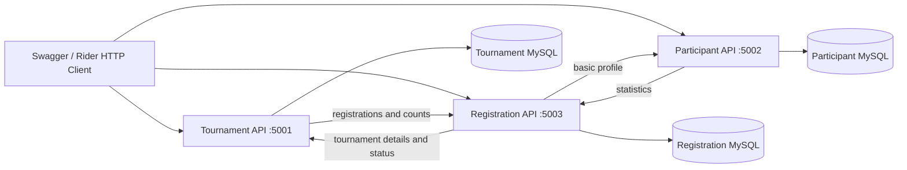
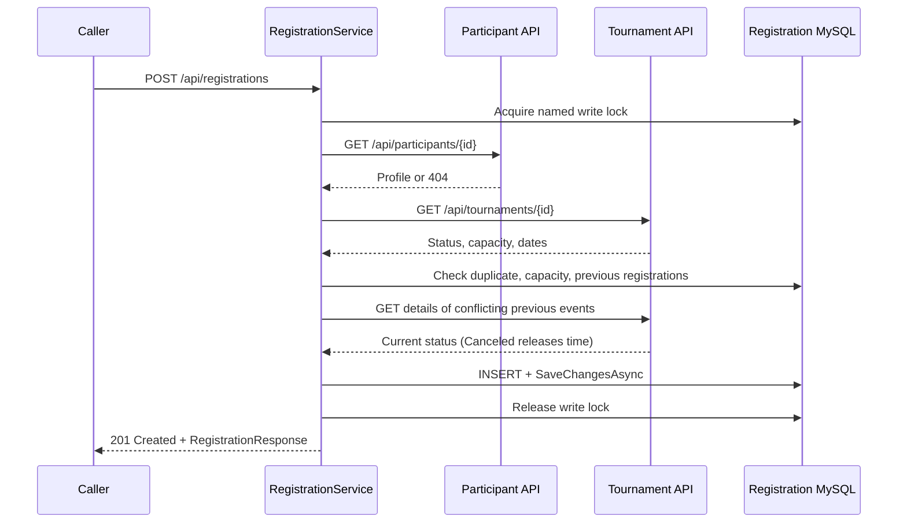
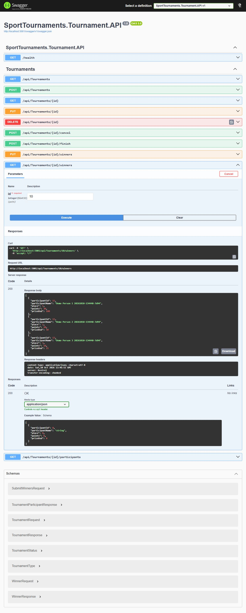
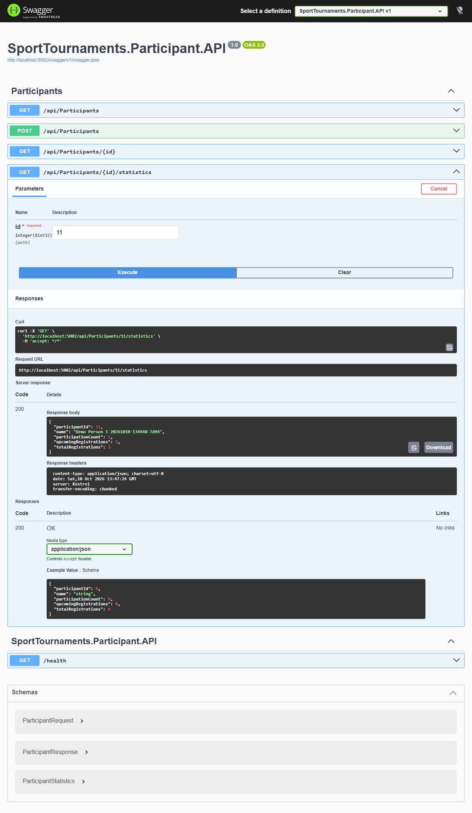
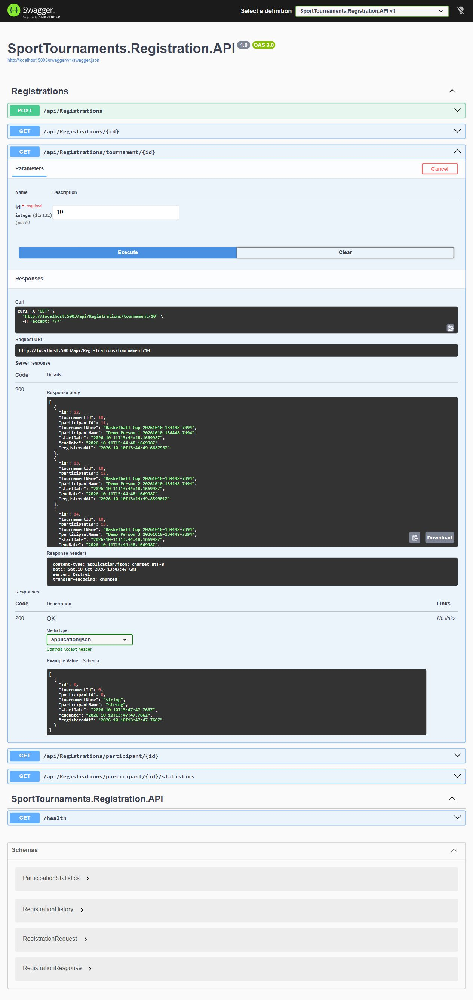

# COS 3123 - Sport Tournaments System

## Business case и актьори

AUBG организира basketball, football и swimming турнири. Организаторът поддържа програмата, капацитета, наградите и резултатите. Участникът се записва в свободен турнир без конфликт с вече заети часове. API caller изпълнява тези роли; authentication не е част от заданието или използвания workshop.

## Domain objects

| Object | Собственик | Полета / предназначение |
|---|---|---|
| Tournament | Tournament service | Id, Name, Type, Description, StartDate, EndDate, Location, Capacity, FirstPrize/SecondPrize/ThirdPrize, Status |
| Winner | Tournament service | Id, TournamentId, ParticipantId, ParticipantName snapshot, Place (1-3), Points |
| Participant | Participant service | Id, Name; един човек може да има много registrations |
| Registration | Registration service | Id, TournamentId, ParticipantId, RegisteredAt; snapshots на имената и часовете |
| TournamentType | Tournament service | Basketball, Football, Swimming |
| TournamentStatus | Tournament service | Upcoming, Finished, Canceled |

Winner → Tournament е реална foreign key връзка в Tournament DB. ParticipantId и TournamentId в чужди услуги са remote identifiers, без foreign keys между базите. Точните snapshots на имената запазват историята, ако Canceled турнир бъде изтрит. Наградите са свойства на Tournament; не е нужен отделен Prize microservice/table. Статистиката е изчисляван DTO, а не допълнителна таблица, която може да стане несъгласувана.

## Functionalities и покритие на стр. 2

| Изискване | Реализация |
|---|---|
| Трите спорта | Enum + validation, `GET /api/tournaments?type=...` |
| Списък Upcoming / ended със start/end/location | GET list със status filter, response съдържа тези полета; Finished list чрез `status=Finished` |
| Add/update/delete | Tournament controller → service → EF; POST status Upcoming |
| Всички details и USD награди | TournamentResponse, GET by ID; decimal(12,2) |
| Upcoming/Finished/Canceled | Специални finish/cancel endpoints; клиентът не може да зададе произволен Status в create/update DTO |
| Capacity | Положителен capacity; signup count < capacity; update capacity ≥ registration count |
| Sign up | Registration проверява и двата remote IDs чрез typed clients |
| Няма coinciding time ranges | `start < otherEnd && otherStart < end`; отхвърля частично/пълно припокриване и еднакви интервали |
| Upcoming participants | Tournament GET participants връща registrations с имена и participation counts |
| Трима winners и points преди Finished | PUT winners приема точно три различни регистрирани хора, места 1,2,3, points ≥ 0; Finish изисква запазени winners |
| Finished winners и points | GET winners + USD prize за всяко място; резултатите стават immutable при Finished |
| Participant name и participation count | GET participant profile и statistics; Tournament participants включва count |
| Забрана за delete Finished | 409, винаги |
| Забрана за delete Upcoming със записвания | 409, използва Registration API; може да се cancel |
| Невалиден start/end | Create изисква future start и EndDate > StartDate; validation преди write |

Тънките controllers превеждат HTTP към method calls и връщат DTOs. Бизнес правилата са в services. EF Core persistence е чрез собствен AppDbContext във всяка Domain library. `[ApiController]` валидира DTO DataAnnotations преди controller action; service също проверява съществените правила.

## Microservices и операции

| Service / port | Business capability | Собствена DB | Основни операции |
|---|---|---|---|
| SportTournaments.Tournament.API / 5001 | Програма, управление и официални резултати | TournamentDB / Tournament | CRUD, filter, cancel, submit winners, finish, participants/winners views |
| SportTournaments.Participant.API / 5002 | Идентичност на участник | ParticipantDB / Participant | Create/list/details, statistics view |
| SportTournaments.Registration.API / 5003 | Записвания и история на участията | RegistrationDB / Registration | Create, query per tournament/person, counts |

**SRP:** промяна в турнири/награди променя Tournament; правила за signup променят Registration; профилни данни променят Participant. **CCP:** данните и правилата, които се променят заедно, са в една услуга. Winner принадлежи към официалния Tournament резултат, не към профила на човека. Registration има различен lifecycle и собствени validations. Няма четвърта услуга само за техническа функция.

## Three-layer architecture - моделът от workshop

```text
SportTournaments.<Name>.API
  Controllers + Program.cs (HTTP, DI, configuration, Swagger)
             ↓ ProjectReference
SportTournaments.<Name>
  <Name>Service + DTOs + typed API clients (business logic)
             ↓ ProjectReference
SportTournaments.<Name>.Domain
  Entities + AppDbContext + Migrations (EF Core / MySQL)
```

API също реферира Domain за `AddDbContext`, както в `bookshop_workshop.md`. Разликите са нужните sports entities/DTOs/business rules, named volumes, устойчиви HTTP failure responses и малки tests. Beginner guide е използван за стандартните controllers, а главният workshop определя окончателната структура.

## Interactions

Комуникацията е синхронен REST/HTTP с JSON. Typed clients са в **Service** projects; `AddHttpClient<T>` и адресите са в **API Program.cs/configuration**. В Docker адресите се override-ват чрез `Services__...` и ползват service DNS + port 8080. При локален debug адресите са localhost:5001-5003.



Стрелките в двете посоки не създават request loop: Registration lookup извиква basic profile/details endpoints, които четат само собствената си DB. Обогатените statistics/participants endpoints са отделни.



За winners Tournament извиква Registration list и валидира принадлежността на всеки winner. Всички winners се заменят в една **локална DB transaction**, след validation. При delete Upcoming Tournament пита Registration дали има записвания. При статистика Participant пита Registration, която взема актуалните Tournament statuses и брои Finished.

`AddStandardResilienceHandler()` осигурява bounded retry/timeouts/circuit breaker. Retry за unsafe HTTP methods е изключен; настоящите typed clients изпращат GET. Изчерпана зависимост дава 503 с ProblemDetails и не позволява signup с липсващи данни. 404 се интерпретира като липсващ обект, а не като network failure. Health проверява собствената DB, без да изисква всички други услуги.

## Интерпретации и ограничения

1. **EndDate:** бележката в PDF забранява end date greater than start date, което би направило нормалните интервали невъзможни. Приета е изрично поисканата логична интерпретация: **EndDate > StartDate**. StartDate трябва да е в бъдещето при create или промяна на часовете.
2. **Време:** входът е DateTimeOffset с ISO 8601 и offset; DB съхранява UTC DateTime. Турнирните dates се нормализират до microseconds за MySQL datetime(6), за да се сравняват правилно след persistence. Два интервала, които само се допират (`end == next start`), са допустими.
3. **Статистика:** `ParticipationCount` брои Finished турнири; `UpcomingRegistrations` брои Upcoming; `TotalRegistrations` включва историческите записвания и canceled/deleted events. Cancel освобождава часовете, но не изтрива историята.
4. **Редакция след signup:** location/name/description/prizes могат да се променят; capacity може да се увеличи или намали до текущия брой. Dates/type се фиксират след първия signup, за да не възникне конфликт за участник. За нов график организаторът cancel-ва и създава нов турнир. Finished/Canceled са immutable.
5. **Winners:** точно три различни registered participants, места 1-3, points ≥ 0. Точките не се използват автоматично за класиране: организаторът задава местата. Няма автоматичен статус по календар. PDF не изисква проверка дали EndDate е минал преди organizer finish; finish е ръчна операция. Това позволява кратка презентация без чакане на реален турнир.
6. **Concurrent signups:** MySQL `GET_LOCK` сериализира записванията и пази capacity/overlap checks и INSERT като една критична секция. Lock е общ за Registration DB, работи и при няколко API instances; освобождава се и при грешка. Unique index `(TournamentId, ParticipantId)` е втори guard срещу дублиране. При load този глобален lock ограничава throughput, приемливо за учебния проект.
7. **Cross-service consistency:** няма distributed transaction между organizer edit/delete/cancel/finish и отделната signup DB. Parallel organizer mutation и signup могат да се състезават между HTTP check и write. Това е известна учебна граница; organizer workflows се изпълняват последователно. За production са нужни reservation/coordination или saga/outbox, които не са в workshop и не са добавени като излишна инфраструктура.
8. **Сигурност:** няма login/roles/payment; caller изпълнява organizer actions. Demo DB credentials са локални учебни. Не е правено deployment към публичен server.
9. **История:** Canceled tournament може да се изтрие според текста на PDF; Registration snapshots остават, status view показва `Deleted`. Participant профилите нямат delete endpoint, за да не се създават dangling participant IDs.

## Screenshots на работещите услуги

Снимките са заснети от истинските Swagger страници след успешния Docker/REST run. Не са mockups. GET заявките показват живи persisted данни. IDs в тях са demo IDs от конкретното изпълнение.

### Tournament



### Participant



### Registration



## Deliverables

Implementation: `SportTournaments.sln`, девет application projects, test project, Dockerfiles, Compose, migrations, configs, demo requests.

Documentation: този файл покрива domain objects, functionalities, services, interactions и screenshots. README има точните start/debug стъпки и endpoints. PRESENTATION/STUDY_GUIDE са личната подготовка за представяне. VERIFICATION и JSON report отделят реалните проверки от ограниченията.
